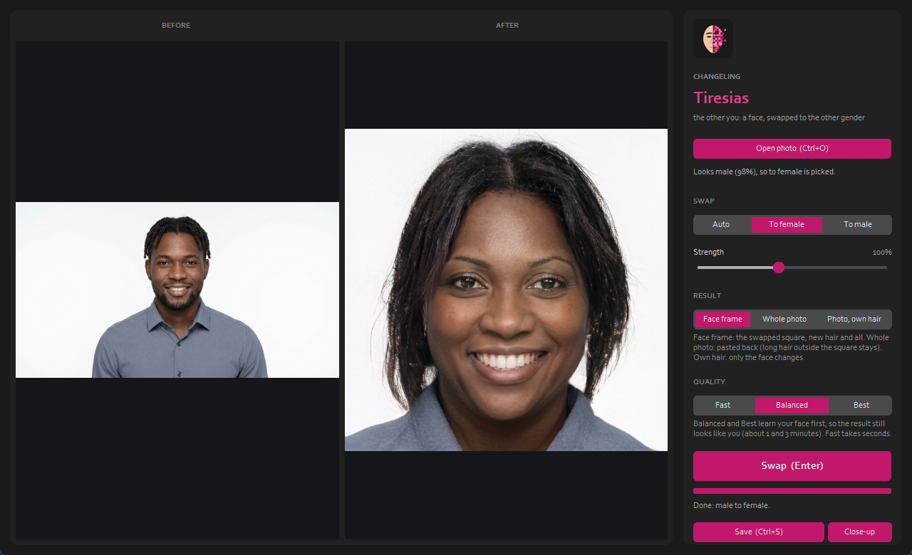

[](https://x.com/NorowaretaGemu)
[](LICENSE)

<div align="center">
  <a href="https://ko-fi.com/cursedentertainment">
    
  </a>
</div>

<br>


<p align="center"></p>

# Changeling Tiresias

**Website:** https://cursedprograms.github.io/Changeling-Tiresias/

**The name.** In Greek myth Tiresias, the blind prophet of Thebes, came upon two snakes mating and struck them with his staff, and was turned into a woman. Seven years later he found the snakes again, struck them again, and became a man. He had lived both lives, so when Zeus and Hera argued over which of them enjoyed love more, they asked him.


*Part of the Changeling family, all together in [Changeling Studio](https://github.com/CursedPrograms/Changeling-Studio):
[Imago](https://github.com/CursedPrograms/Changeling-Imago) ·
[Imago Realtime](https://github.com/CursedPrograms/Changeling-Imago-Realtime) ·
**Tiresias** (gender) ·
[Chronos](https://github.com/CursedPrograms/Changeling-Chronos) (age) ·
[Natio](https://github.com/CursedPrograms/Changeling-Natio) (where in the world) ·
[Cosmeta](https://github.com/CursedPrograms/Changeling-Cosmeta) (makeup, hair, beards) ·
[Echo](https://github.com/CursedPrograms/Changeling-Echo) (voices) ·
[Tonsor](https://github.com/CursedPrograms/Changeling-Tonsor) (hairstyles) ·
realtime: [Tiresias](https://github.com/CursedPrograms/Changeling-Tiresias-Realtime) ·
[Chronos](https://github.com/CursedPrograms/Changeling-Chronos-Realtime) ·
[Natio](https://github.com/CursedPrograms/Changeling-Natio-Realtime) ·
[Cosmeta](https://github.com/CursedPrograms/Changeling-Cosmeta-Realtime).*

Named after Tiresias, the seer of Greek myth who lived seven years as a woman. Every face above is an
AI-generated person who doesn't exist; use it on yourself, on generated people, or on people who agreed.

FaceApp-style gender swap for photos. FaceApp's own model is proprietary, so this uses the
open-source approach that gives the same kind of result: a StyleGAN2 face generator edited in latent space.

1. **Detect & align** the face with OpenCV YuNet, cropping it the way FFHQ (StyleGAN2's training set) was cropped.
2. **Invert** the crop into StyleGAN2's W+ latent space with the [e4e](https://github.com/omertov/encoder4editing) encoder.
3. **Pivotal Tuning** ([PTI](https://github.com/danielroich/PTI)): briefly fine-tune the generator on your face so the result still looks like you (skipped in `fast` mode).
4. **Edit**: move the latent along a learned gender direction ([source](https://github.com/a312863063/generators-with-stylegan2)).
5. **The result** is the swapped face frame itself (the default: its new hair is whole). **Whole photo**
   pastes it back into the original with a feathered blend (long hair outside the frame stays as it was;
   Changeling Studio will clean that up with inpainting), and **Photo, own hair** pastes back only the face
   itself (a soft oval), so the photo keeps its own hair.

## Setup

Requires Python 3.9 - 3.12; an NVIDIA GPU is strongly recommended (4 GB is enough).
Just run the launcher for your shell. On first run it creates the `psdenv` virtual environment,
installs `requirements.txt` (again whenever that file changes) and downloads any missing models
(about 1.3 GB, into `pretrained/`). Arguments are passed through to `main.py`.

```
run.bat                        # Windows (double-click or cmd)
.\run.ps1                     # PowerShell
./run.sh                       # Linux / macOS / Git Bash
run.bat photo.jpg --quality best
```

If PowerShell refuses to run scripts: `powershell -ExecutionPolicy Bypass -File run.ps1`.
To only fetch the models: `python main.py --download-models`.

## Usage

```
python main.py                                   # the window
python main.py photo.jpg                         # writes photo_swapped.jpg
python main.py photo.jpg --to female --strength 1.3 --quality best -o out.png
```

| Option | Meaning |
| --- | --- |
| `--to auto\|female\|male` | Target gender. `auto` (the default) flips whatever is detected. |
| `--strength` | How far to push the edit (1.0 = full swap). |
| `--quality fast\|balanced\|best` | `fast` = encoder only (a few seconds); `balanced`/`best` fine-tune on your face for 100/250 steps (~1 / ~3 min on a GTX 1050 Ti). |
| `--save-crops` | Also save the aligned input, reconstruction and edit side by side. |
| `--whole-photo` | Paste the swap back into the whole photo (default: just the swapped face frame). |
| `--keep-hair` | Whole photo, but only the face changes; the photo keeps its own hair. |

### The window




Changeling's look: **Before** and **After** side by side, the controls on the right. You don't have to pick
a direction: when you open a photo, a gender classifier (FairFace) reads the face and picks the opposite
("Looks **male** (99%), so **to female** is picked"); you can still change it. **Swap** runs on its own
thread with a completion bar while it learns your face, **Result** picks the face frame, the whole photo, or the photo with its own hair, **Save** writes the result, **Close-up** shows
the aligned face, the reconstruction and the result side by side.

| Key | Does |
| --- | --- |
| <kbd>Ctrl</kbd>+<kbd>O</kbd> | open a photo |
| <kbd>Enter</kbd> | swap |
| <kbd>Ctrl</kbd>+<kbd>S</kbd> | save the result |
| <kbd>Esc</kbd> | quit |

## Licenses

The code here is MIT-derived (e4e, rosinality/stylegan2-pytorch). The pretrained StyleGAN2 FFHQ
weights are under NVIDIA's non-commercial license, so this is for personal/research use.

---

<br>
<div align="center">
© Cursed Entertainment 2026
</div>
<br>
<div align="center">
<a href="https://cursed-entertainment.itch.io/" target="_blank">
    
</a>
</div>
<br>
<div align="center">
  <a href="https://github.com/SynthWomb" target="_blank">
    
  </a>
</div>
